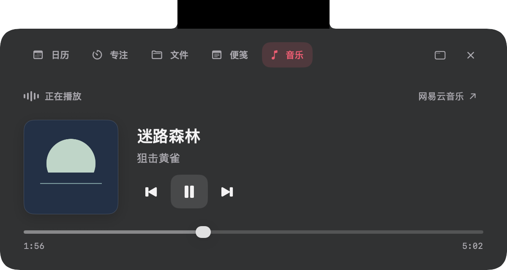
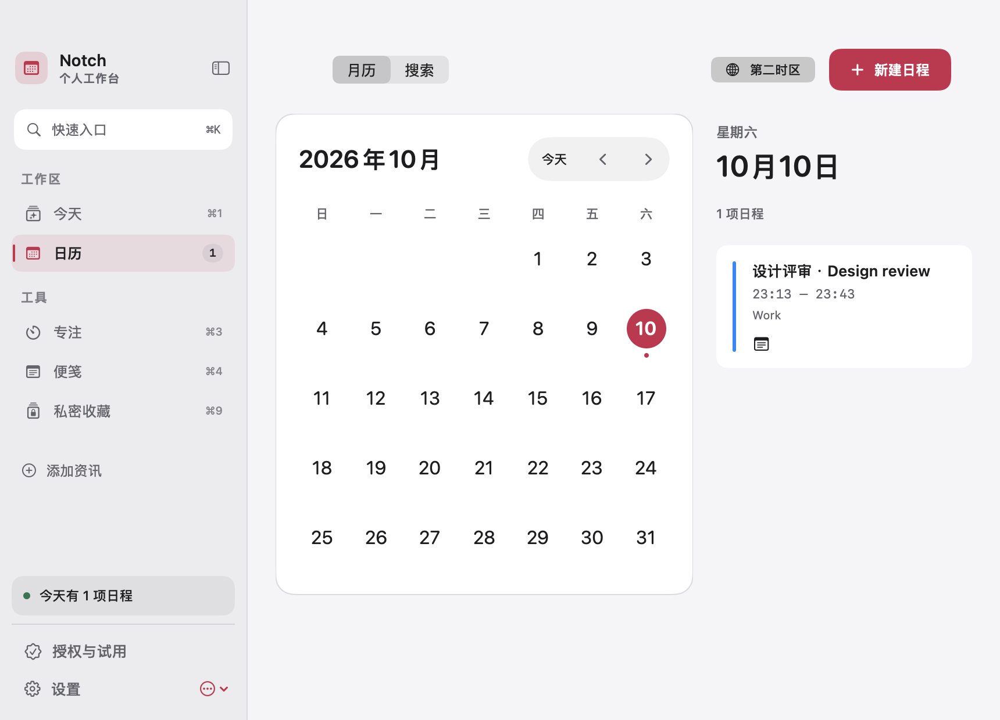
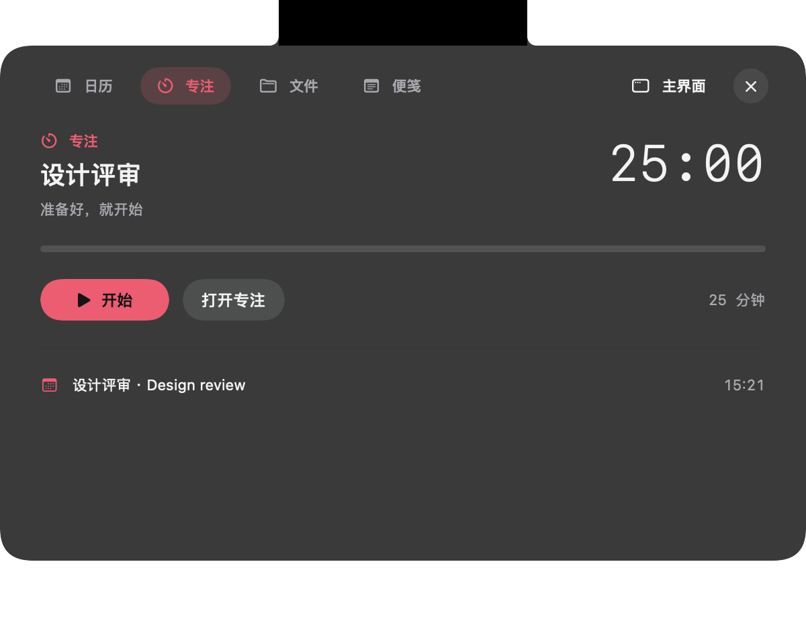
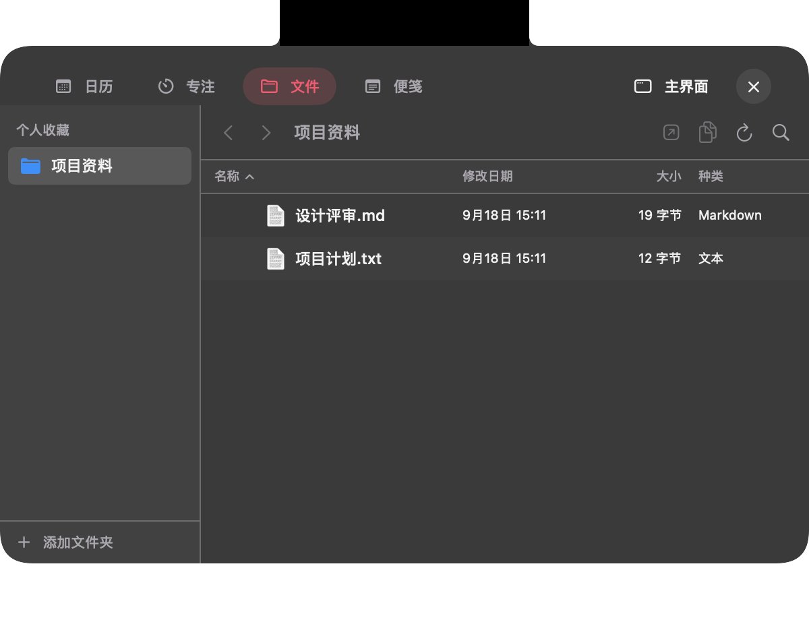
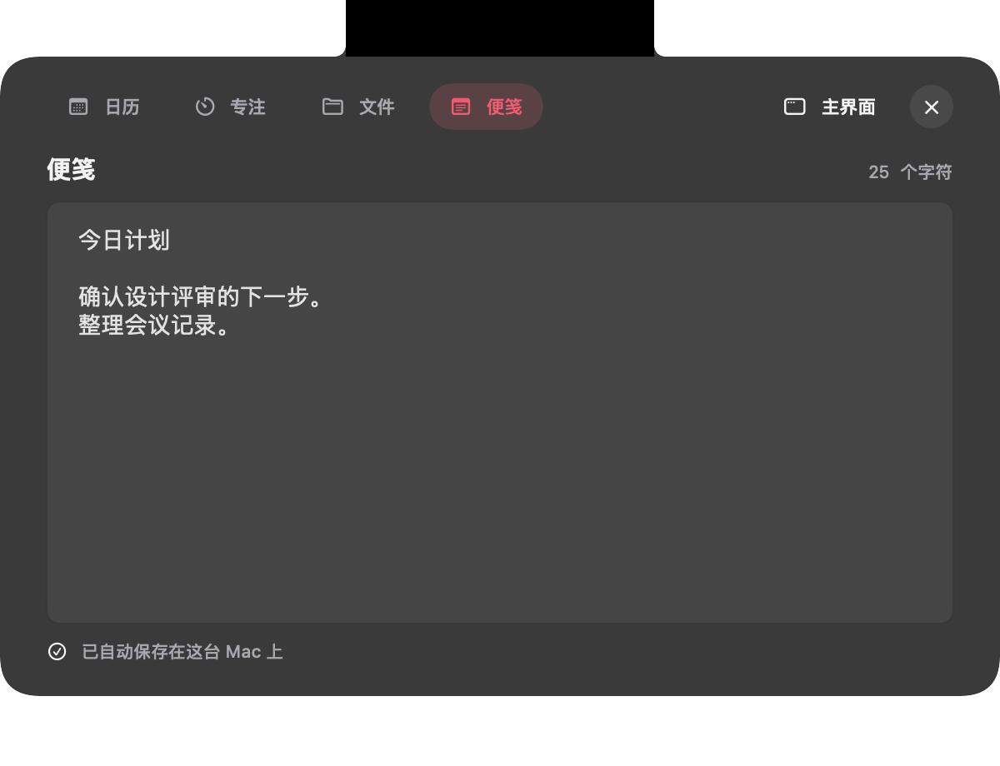
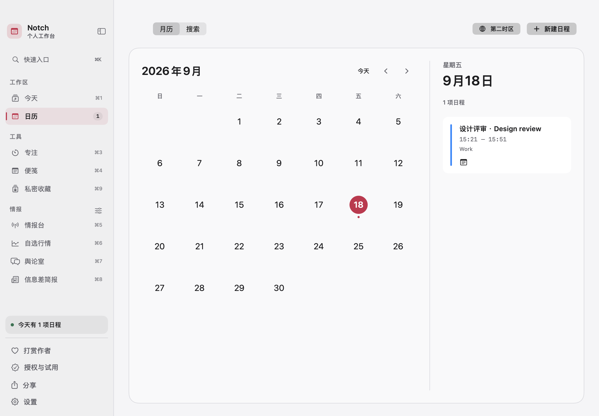
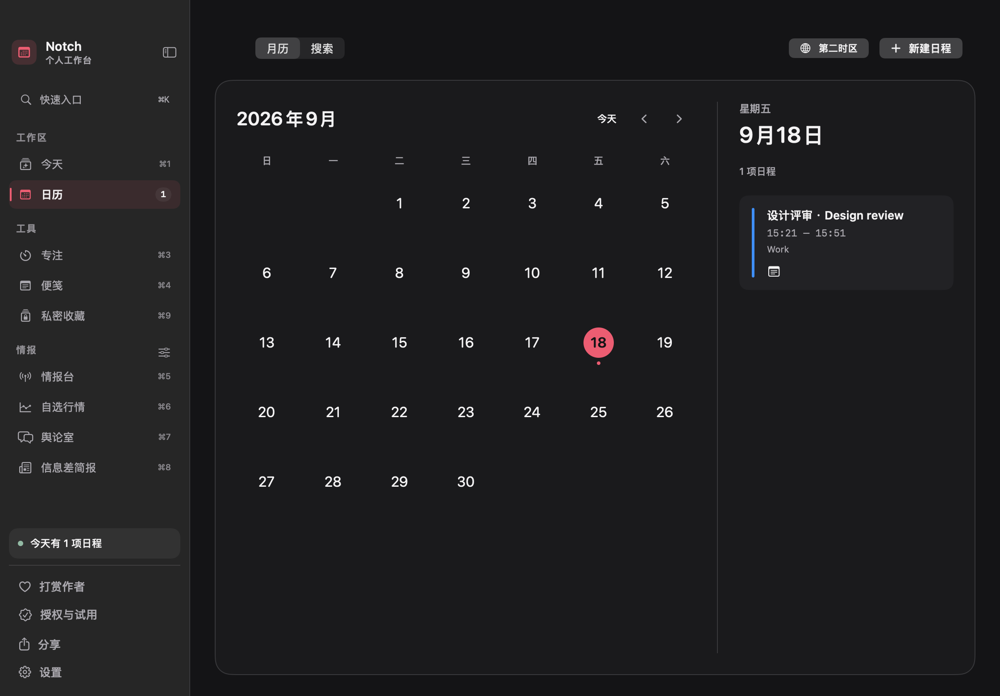
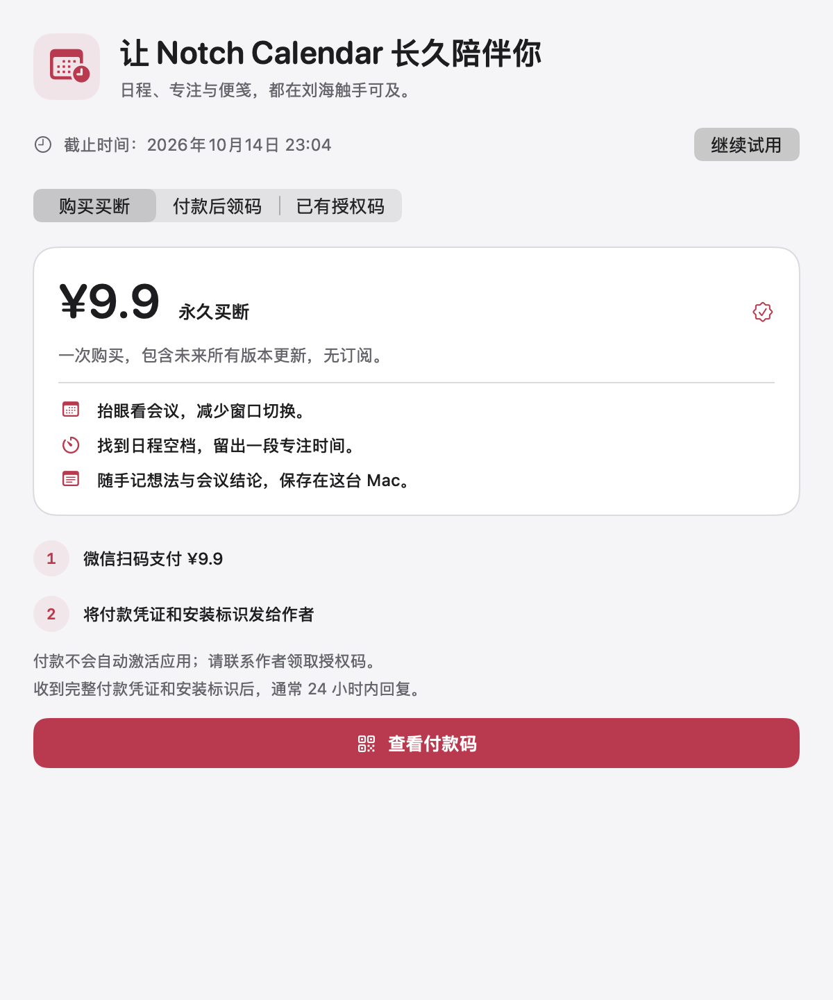

# Notch Calendar

Open your calendar, focus timer, music controls, files, and scratchpad from the Mac notch. The full workspace offers light and dark appearances with an optional translucent glass material.

[简体中文](README.md) · [Download](https://github.com/GpsLypy/NotchCalendar/releases/latest) · [Report an issue](https://github.com/GpsLypy/NotchCalendar/issues)

## Fixed in 1.7.5: Central notch hover and compact focus countdown

- Restore hover opening over the central hardware notch during music playback. The artwork and rhythm circles remain click targets, and moving the pointer away closes the browsing panel after the exit grace period.
- Keep the compact focus countdown within the right shoulder, preventing clipped time text and capsule edges after opening and closing the panel.

Version 1.7.5 (build 72, 2026-10-12) requires macOS 15+ and supports Apple silicon and Intel. This ad-hoc signed build requires manual installation and has no Developer ID signing or Apple notarization. At the user's explicit request for immediate publication, release regression tests, artifact checks and SHA-256 verification were skipped. Tests were not rerun after the focus layout fix; this release does not claim those checks passed. See the [1.7.5 release notes](RELEASE_NOTES.md).

## New in 1.7.4: Click to open Music, leave to close Calendar

- Compact music artwork and rhythm open only on a click; hovering no longer opens the player.
- Beside a hardware notch, music input is limited to the two visible circles. Transparent shoulders and rounded corners pass clicks through to the menu bar, and the input region updates promptly during fast pointer movement to prevent accidental opening.
- With hover opening enabled, clicking Music and then switching to Calendar allows the panel to close after the exit grace period when the pointer leaves, including when it rests on neighboring menu-bar controls.
- Scratchpad, Files and Focus editing, the global click-only preference, and native popovers, sheets and modal dialogs retain continued interaction sessions.

Version 1.7.4 (build 71, 2026-10-12) requires macOS 15+ and supports Apple silicon and Intel. This ad-hoc signed build requires manual installation and has no Developer ID signing or Apple notarization. Physical displays, real desktop frame rate, energy use and stationary performance, live-player compatibility, VoiceOver, Keychain dialogs, live payment/activation and real sleep/wake/login behavior remain pending; see the [1.7.4 release notes](RELEASE_NOTES.md) for the validation scope.

## New in 1.7.3: Keep working after a glance

- A brief pointer exit gets a grace period after hover opening. Clicking the panel keeps the interaction open while the pointer moves away; click outside, press Esc, or use Close to dismiss it.
- Opening takes about 0.32 seconds, closing 0.24 seconds, and pages fade in over 0.14 seconds. Narrow navigation keeps fixed icon widths when switching pages.
- A complete close and reopen retains the scratchpad's selection and independent undo history, plus file selection and scroll position. External note updates invalidate old undo actions while respecting input-method composition.
- File-open, copy, and child-folder failures show a dismissible message while keeping the current directory. Reads made obsolete by a collapsed parent or directory change cannot write back.
- The file list supports arrow navigation, left/right collapse and expansion, Home/End, Return to open, ⌘C to copy, and Tab/Shift-Tab focus navigation. Hidden pages do not intercept keys.

Requires macOS 15+ and supports Apple silicon and Intel. This ad-hoc signed build requires manual installation and has no Developer ID signing or Apple notarization. Real desktop frame rate and energy use, physical displays, and live-player compatibility remain pending; see the [1.7.3 release notes](RELEASE_NOTES.md) for the validation scope.

## New in 1.7.2: A more compact and clearer notch panel

- Music fits its content without a large empty area below the player. Artwork, track information and playback controls have balanced spacing, and an album name that repeats the song title is omitted.
- Labeled navigation at the standard panel width and consistent hover, pressed, focus and disabled feedback make controls clearer. The translucent panel reduces desktop color tint for better contrast.
- Tab changes retain calendar and file browsing state, as well as the scratchpad's selection and undo history.

Requires macOS 15+ and supports Apple silicon and Intel. This ad-hoc signed build requires manual installation and has no Developer ID signing or Apple notarization. See the [1.7.2 release notes](RELEASE_NOTES.md) for download and validation details.

## New in 1.7.1: Smoother notch opening and closing

- The shell expands first, then content fades in with a slight scale and downward movement. Content fades out before the shell finishes closing.
- Quickly reversing the transition continues from the visible shape. The compact notch no longer squeezes past its final size, and hidden editors release input focus.
- Reduce Motion uses fading without moving or scaling content.

Requires macOS 15+ and supports Apple silicon and Intel. This ad-hoc signed build requires manual installation and has no Developer ID signing or Apple notarization. See [release notes](RELEASE_NOTES.md) for the validation scope.

## New in 1.7.0: Music beside the notch

- Album art and a gentle rhythm appear on separate sides of the notch during playback. Meetings and focus take priority; turn off Show music beside the notch in Settings when needed.
- Open Music in the notch to see the system's current track, artist, album, artwork and source player. Previous, play/pause, next and seeking follow the capabilities reported by the player.
- Swipe horizontally across the artwork and track area to change tracks, or use the buttons. Space plays or pauses; Reduce Motion keeps the rhythm still.

The rhythm is a decorative playback animation, not a live audio waveform. This version does not claim unverified Lossless, Dolby Atmos or exclusive audio formats, and it does not add a lock-screen music widget. Actual Apple Music, Spotify and other player compatibility remains pending live playback acceptance; controlled demo playback does not establish full compatibility. See [release notes](RELEASE_NOTES.md).

Native window compositor capture at measured content height, with synthetic song metadata and artwork; this does not establish physical-notch or live-player acceptance.

## New in 1.6.22: Clearer daily work and purchase steps

- Today prioritizes the next meeting, focus and note shortcuts, and available focus time. Add optional insights when needed; saved visibility choices are retained.
- Smaller windows keep the month and selected-day agenda side by side. Primary buttons are clearer, and notch meeting titles wrap to two lines with full text on hover.
- Purchase, Claim a code and I have a code each provide a direct path. The CNY 9.90 lifetime price, future updates and manual code delivery are explained before payment.

| Today workspace | Compact calendar |
| --- | --- |
|  |  |

### Separate notch-side activity islands

The focus icon and countdown, or meeting title and progress, sit on separate islands beside the camera housing. The centre stays clear instead of becoming one wide black notch.

| Focus timer | Active meeting |
| --- | --- |
|  |  |

Native compact-view captures use isolated demo data; the menu bar and camera housing are composited, not a photo of the display.

## Open from the notch

Hover over or click the top entry for Calendar, Focus, Scratchpad, and Music. Enable the optional file shelf in Settings to add Files; displays without a notch have a centered top entry.

| Calendar | Focus |
| --- | --- |
|  |  |
| Files (opt in) | Scratchpad |
|  |  |

## Light, dark, and glass

Set the full workspace to light, dark, or system appearance, with optional translucent glass material. The notch panel remains dark.

| Light workspace | Dark workspace |
| --- | --- |
|  |  |

These native SwiftUI offscreen captures use isolated demo events, files, and notes. They do not include a physical notch or desktop background and cannot demonstrate actual desktop refraction.

## New in 1.6.21: Symmetric capsules and quiet check-in reminders

- Circular capsules share mirrored sizing, spacing and centered content. Check-ins show a red pending-count badge and gently pulse above two pending items; Reduce Motion keeps the reminder static.
- Details open only when you click the capsule, with no automatic popover on launch, wake or new reminders. Completing all items hides it.

## New in 1.6.20

- The check-in popover now has only Hide reminder and Done. Completion is saved separately, so changing today's time window will not bring a finished check-in back. Editing a window can restore an empty legacy check-in when the new window includes the current time; older versions could not distinguish completion from removal.

## New in 1.6.19

- The check-in reminder fits its pending items instead of showing a large empty panel. Hide reminder keeps the notch capsule and pending item; Remove clears that entry, separately from Done.

## Fixed in 1.6.18

- Fix a crash in v1.6.17 when macOS posts the calendar-day change from a background thread. Check-in and meeting wake notifications now enter their main-thread handlers safely.

## New in 1.6.17

- A check-in capsule appears to the left of the notch. Morning (08:00–10:00) and evening (18:00–20:00) reminders appear on launch, wake, or when the running app enters either window. Check-ins remain until completed or removed; click the capsule to reopen a closed reminder.
- Set both time windows in Settings > General > Check-in reminders. The installed app requests launch at login by default; this can be disabled, and macOS may require approval in Login Items.

## New in 1.6.15

- Cancel a running or paused focus session from the notch panel to dismiss its capsule without counting it as completed.
- Click to expand while focus or meeting islands are visible; idle behavior follows your hover or click preference.

## New in 1.6.14

- Compact activities occupy separate islands on either side of the notch; choose light, dark, or glass styling in the full workspace.
- Refined Calendar, Focus, Files, and workspace interactions, with offline poetry and private bookmarks.

## New in 1.6.13

- Calendar updates no longer resize the notch panel in the middle of its opening reveal. Closing or reopening cancels an older height adjustment.
- On short displays, expanded content scrolls vertically; narrow displays can scroll horizontally while keeping the top controls available.
- The following trial, purchase, and data-access features continue from 1.6.12:

- Use the seven-day trial without repeated purchase prompts; a dismissible reminder appears only in the final 48 hours.
- CNY 9.90 buys lifetime use including all future versions, with no subscription. Purchase details and manual code delivery are explained before you choose to reveal the QR code; payment does not activate automatically.
- After expiry, My data remains available for read-only notes, focus history and file locations, ordinary backup export, and separately authenticated private-bookmark export.
- Hide or show the workspace sidebar without losing navigation shortcuts. Optional tips do not purchase a license.

## Personal workspace

- Offline daily classical Chinese poetry, with saved verses and a collapsible card.
- Encrypted private website bookmarks, protected by system authentication and automatic locking.
- An optional guide in Settings for Calendar, Focus, or saving a poem.
- Optional insight modules that can be hidden from navigation, shortcuts, and quick search.
- Copyable activation requests and prefilled email drafts, plus voluntary author support.

Private bookmarks are excluded from ordinary JSON backups. After expiry, export them separately only after system authentication; the resulting file is not encrypted, so store it securely. Keep the encrypted vault and its Keychain key backed up together. Links open in your default browser and may appear in browser history. See [release notes](RELEASE_NOTES.md).

Requires macOS 15 or later. Supports Apple silicon and Intel Macs. Download the DMG, move the app to Applications, and launch it.

The new licensed distribution is closed source. First launch automatically starts a **7-day free trial** without opening a payment window. A **one-time CNY 9.90 payment** grants lifetime use **including all future versions**, with no subscription. After expiry, your local data remains readable and exportable. Activated users no longer receive automatic payment prompts. Historical MIT releases retain their original terms; check the release notes for the downloaded version.

## Permanent activation

1. Open License & trial from the workspace sidebar or Settings, choose Purchase, read the manual steps, then reveal the WeChat QR code and pay CNY 9.90.
2. Choose Claim a code to copy request details or prepare an email. Attach your payment receipt and send the email yourself.
3. The author usually replies within 24 hours after receiving a complete receipt and installation ID. Choose I have a code, paste the author-issued code and press Return. Payment does not activate the app automatically.

Email: **498988598@qq.com** · Phone: **13191513539**

We usually reply within **24 hours** after receiving a complete payment receipt and installation ID. Replacement codes for a new Mac or reinstallation are free with proof of purchase, with no annual limit, for your own use only. If your code is missing, reply to the same email with your receipt and current installation ID; do not pay again.

Codes are verified offline and bound to an installation. Contact the author for a replacement when changing Macs or losing the installation's Keychain record. License records are stored in macOS Keychain and excluded from ordinary settings backups.

Calendar access uses EventKit. Notes and focus history remain local. Public feeds and update checks use network access. WeChat handles payment; the app does not automatically confirm payment or access payment accounts.

This repository contains public documentation, required images, and license notices. Installers are distributed through Releases. See [LICENSE](LICENSE) and the [historical MIT notice](THIRD_PARTY_NOTICES.md).
