# superNotch

**Keep the tools you need beside your Mac notch.**

Calendar, focus, tasks, files, notes, music, translation, AI and everyday tools in a native macOS workspace. Open the notch panel, switch tools, and continue in the full workspace when you need more room.

[简体中文](README.md) · [Website](https://sweetchoice.cn/item/notchcalendar) · [Download 4.3.12](https://github.com/GpsLypy/NotchCalendar/releases/tag/v4.3.12) · [Release notes](RELEASE_NOTES.md) · [Report an issue](https://github.com/GpsLypy/NotchCalendar/issues)

macOS 15+ · Apple silicon & Intel · 简体中文 / English · 7-day trial · CNY 9.90 lifetime license

## Current interface

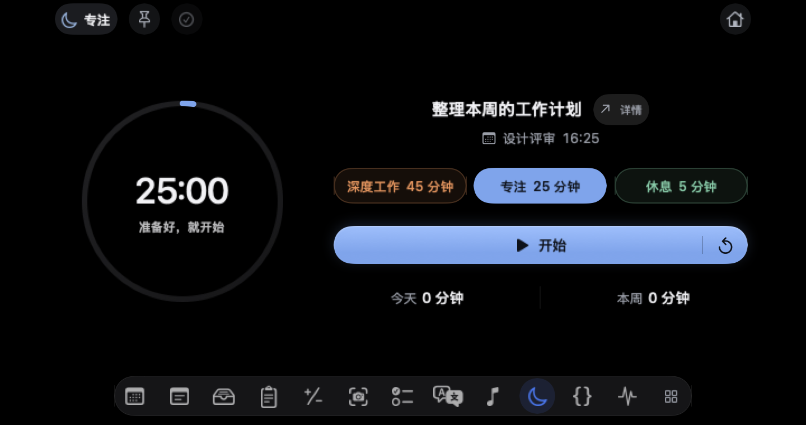

Screenshots exported on November 18, 2026 from the current production views using isolated demo content. These are offscreen native view renders, not photographs of a physical notch. UI text in the images is Simplified Chinese; English is also supported. AI quotas, tasks and system readings are examples.

| Calendar & upcoming events | Tasks |
| --- | --- |
| 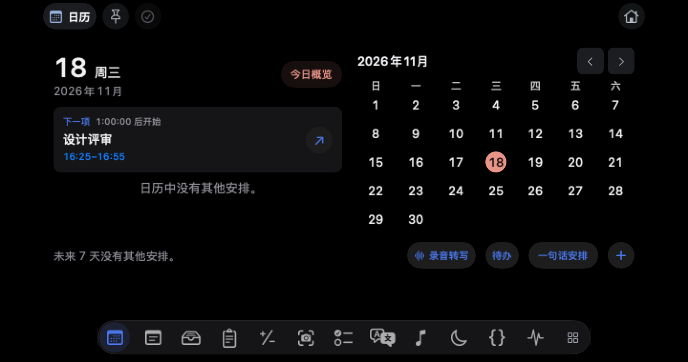 | 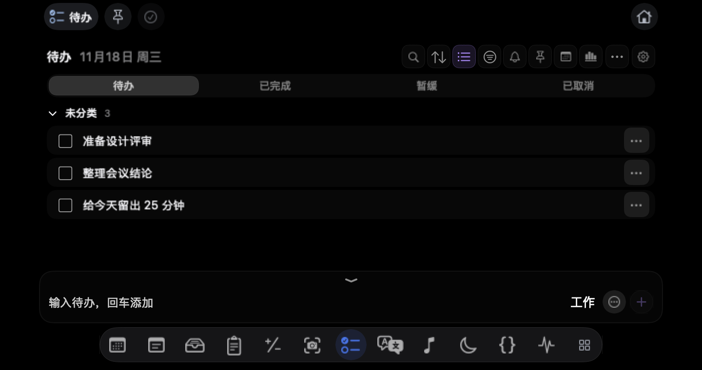 |
| Files | Notes |
| 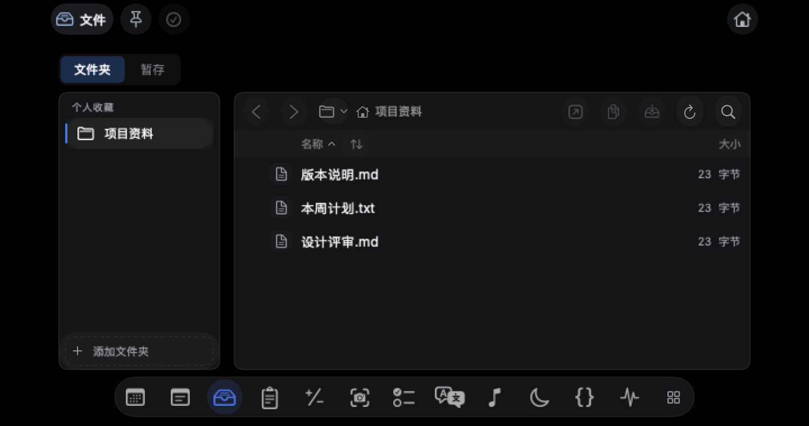 | 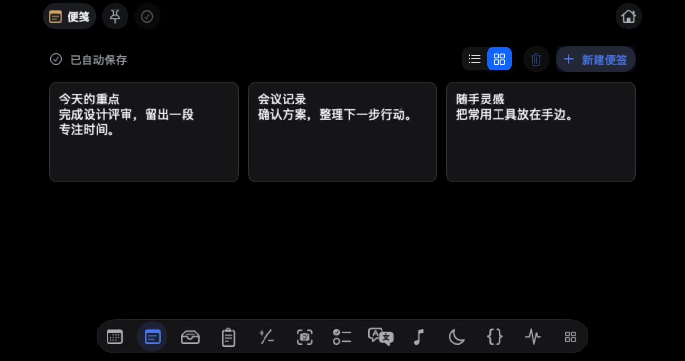 |
| Translation | System monitor |
| 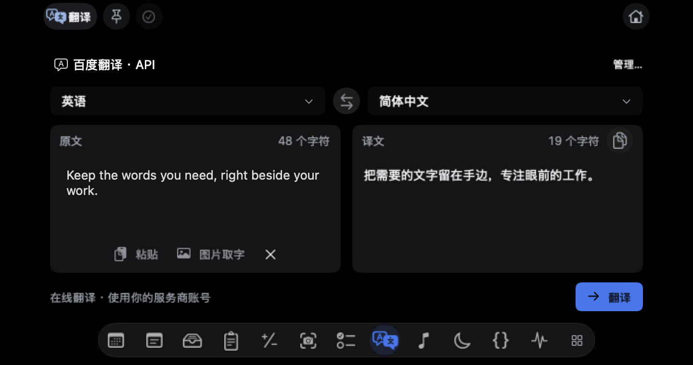 | 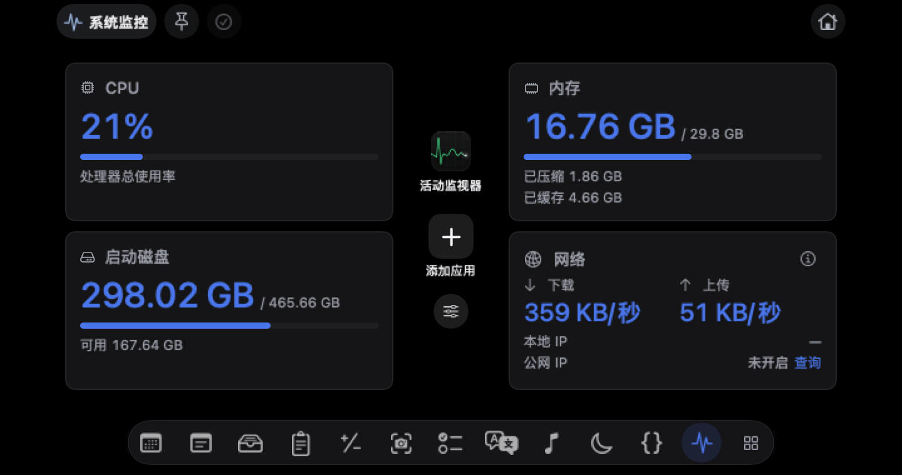 |
| Developer tools | Capture |
| 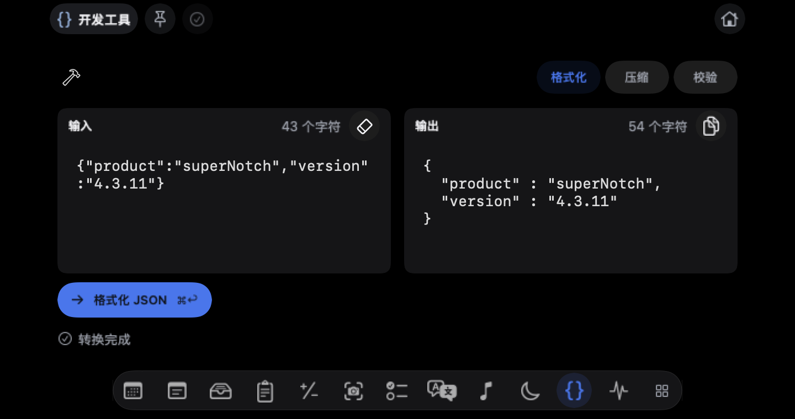 | 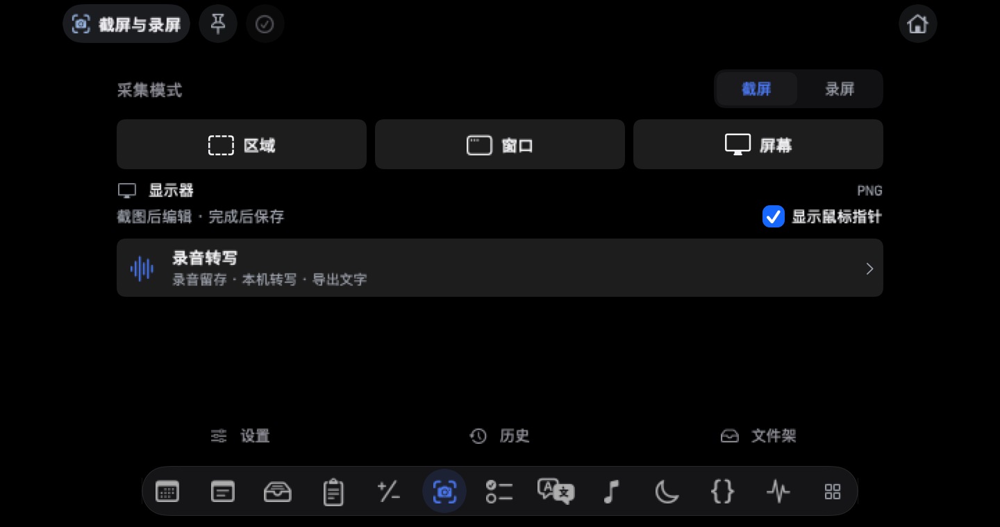 |
| Music | Clipboard |
| 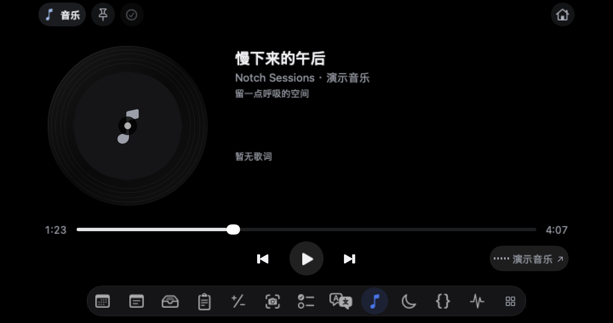 | 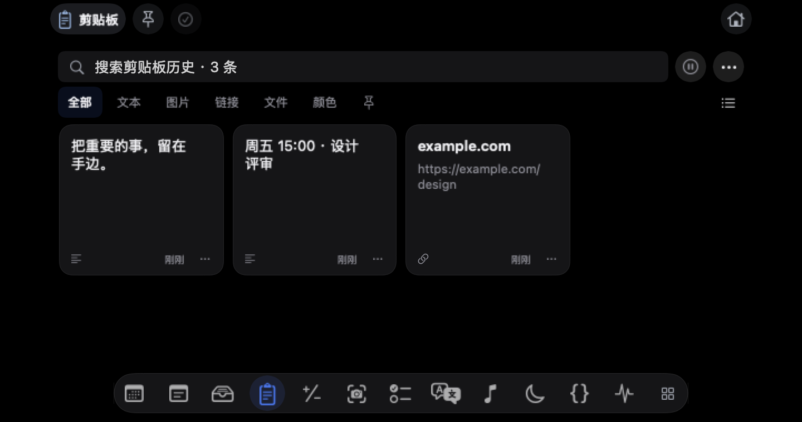 |
| AI coding activity | Assistant capabilities |
| 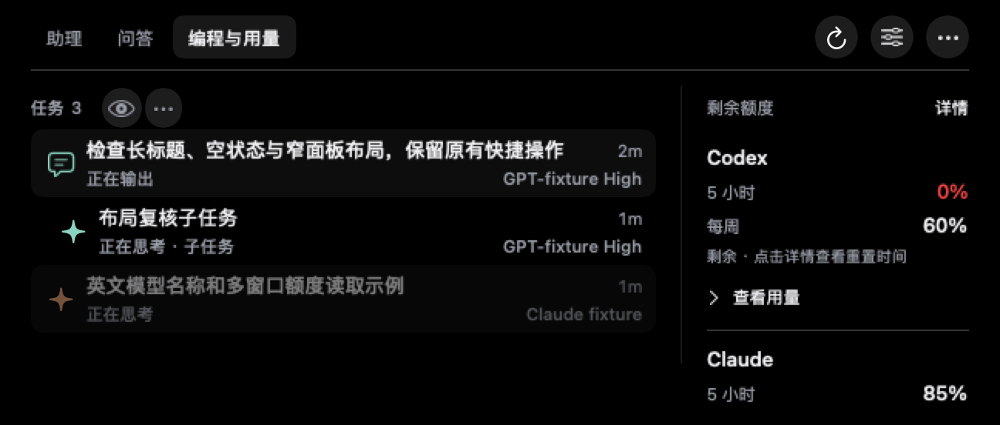 | 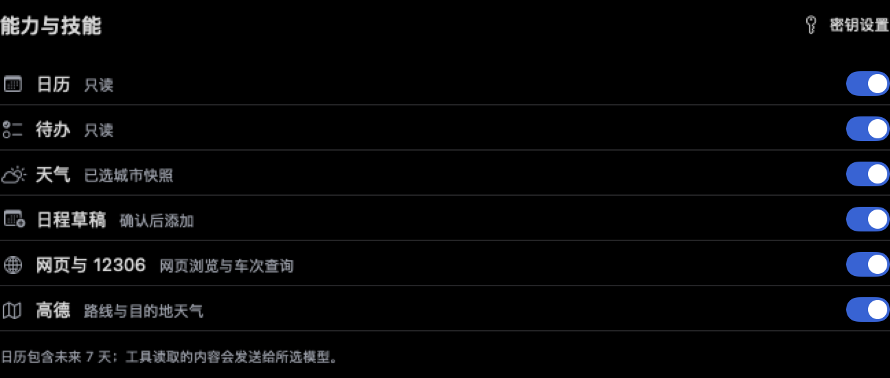 |

The last two images show AI page content without the outer notch toolbar. [Image sources and scope](images/current-4.3.11/manifest.json).

## What you can do

- **Plan and focus:** view system calendars, upcoming meetings and free time; manage tasks, focus sessions and weekly reviews.
- **Keep things nearby:** browse favorite folders, prepare AirDrop sharing, save note cards and search optional clipboard history.
- **Read and work:** translate through selected websites or your official API credentials, recognize image text locally, and use JSON, timestamp, UUID and other developer tools.
- **Use AI with your own services:** website or API chat, assistant tasks, coding activity and quotas. Optional components support MCP tools, Skills and execution records; configure the required model and services first.
- **Capture and monitor:** screenshots, recording and meeting transcription; CPU, memory, disk and network information.
- **Make it yours:** light or dark workspace, optional translucent materials, adjustable notch size, searchable tool library and display selection.

## Latest release: 4.3.12

Build 205 · November 18, 2026. Reduces repeated notch layouts, system-monitor measurements and clipboard formatting; adds network details and optional public IP lookup, and improves startup click expansion and Port Management dismissal.

[DMG](https://github.com/GpsLypy/NotchCalendar/releases/download/v4.3.12/NotchCalendar-4.3.12-macos.dmg) · [ZIP](https://github.com/GpsLypy/NotchCalendar/releases/download/v4.3.12/NotchCalendar-4.3.12-macos.zip) · [SHA-256](https://github.com/GpsLypy/NotchCalendar/releases/download/v4.3.12/SHA256SUMS.txt) · [All releases](https://github.com/GpsLypy/NotchCalendar/releases)

## Install and first launch

Open the DMG, drag superNotch into Applications, wait for copying to finish, then launch it from Applications. The package includes installation instructions.

The manual distribution is ad-hoc signed and has not been notarized by Apple. After confirming the official download and checksum, use System Settings → Privacy & Security → Open Anyway if macOS blocks the first launch. If download quarantine still prevents opening, run:

```sh
sudo xattr -rd com.apple.quarantine "/Applications/superNotch.app"
```

Enter your Mac administrator password; Terminal does not show characters as you type. For the older app name, use `/Applications/Notch Calendar.app`. If macOS reports damage, download the official package again and verify `SHA256SUMS.txt`. [Apple's guidance](https://support.apple.com/en-us/102445).

## License, privacy and permissions

The current app is closed source. CNY 9.90 is a one-time lifetime purchase, including future versions; payment requires an author-issued activation code. Send your receipt and installation ID to **498988598@qq.com**. Historical MIT versions retain their original license; see [LICENSE](LICENSE) and [THIRD_PARTY_NOTICES.md](THIRD_PARTY_NOTICES.md).

Calendar, microphone, screen recording and other permissions are requested for the corresponding features. Third-party AI and translation send submitted content to the configured provider and may require an account or API credentials. Local OCR does not automatically submit recognized text to translation websites. Optional AI components currently target Apple silicon. Actual service login, live APIs, native interactions, external displays, Intel hardware and sustained performance still require device acceptance.
