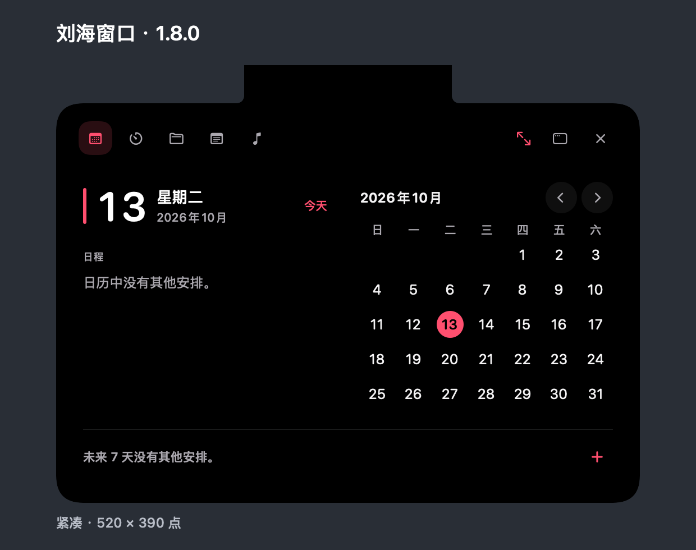

# Notch Calendar

从 Mac 刘海展开日历、专注、音乐、计算器、文件、便笺、剪贴板和 AI 聊天；完整工作台支持浅色、深色与可选毛玻璃材质。

[English](README.en.md) · [下载](https://github.com/GpsLypy/NotchCalendar/releases/latest) · [反馈问题](https://github.com/GpsLypy/NotchCalendar/issues)

## 1.8.8：修复聊天设置卡住与窗口叠加

- 修复聊天设置打开后，点击外部导致刘海收起、输入框与取消按钮一起失效的问题。
- 设置窗口打开时保持父面板活动；切换工具或强制收起时关闭设置，避免再次展开后覆盖日历。
- 验证模型输入、取消、Esc、保存、重复打开，以及延迟点击不会抢走设置窗口的键盘焦点。

1.8.8（build 81，2026-10-15），支持 macOS 15+、Apple 芯片与 Intel，ad-hoc 签名、手动安装。Swift 全量执行 590 项：565 项通过、25 项按需或环境跳过，零失败。 21 项 Python 质量检查通过。详见 [1.8.8 发行说明](RELEASE_NOTES.md)。

## 1.8.7：独立剪贴板历史与 AI 聊天

- 「剪贴板」（⌘7）是独立历史列表，不并排显示月历。手动开启后记录文字、图片与文件引用，支持搜索、复制、置顶、删除、清空和暂停，最多本地保存 100 条。
- 「AI 聊天」（⌘8）支持 OpenAI Responses 与兼容 Chat Completions 的接口，可配置地址和模型，API Key 保存在本机钥匙串。
- 支持流式回复、多轮、停止、重试与手动文本附件。新配置默认 Responses；原有配置可在聊天设置中切换协议，同一服务的密钥无需重填。
- 剪贴板默认不记录，聊天不会自动读取其他工具内容；聊天与草稿仅保留在本次进程内存中，退出后消失。

本版为 1.8.7（build 80，2026-10-15），支持 macOS 15+、Apple 芯片与 Intel，沿用 ad-hoc 签名与手动安装。26 项新增功能定向测试和中英文五档尺寸原生交互通过；网络采用受控响应，尚未使用真实密钥联调。详见 [1.8.7 发行说明](https://github.com/GpsLypy/NotchCalendar/releases/tag/v1.8.7)。

全量回归执行 588 项 Swift 测试，563 项通过、25 项按条件跳过、零失败；21 项 Python 质量检查通过。

## 1.8.6：专注结束有声音，打卡对号有动画

- 专注或休息计时结束时播放一声短提示音；在后台计时也会提醒。专注页提供声音开关，并记住选择。
- 提示音只响一次；暂停、重置以及重新启动或恢复已结束的计时不会重复提醒。
- 「打卡」胶囊的对号在提醒出现和点击时描画一下；点击立即打开详情，开启系统“减少动态效果”时显示完整静态对号。

本版为 1.8.6（build 79，2026-10-14），支持 macOS 15+、Apple 芯片与 Intel，沿用 ad-hoc 签名与手动安装。Swift 全量执行 560 项：535 项通过、25 项按需或环境跳过，零失败；21 项 Python 质量检查通过。后台提醒、静音开关、连续点击与中英文宽窄窗口已本地验证；完整实体设备和真实集成验收仍待完成。详见 [1.8.6 发行说明](RELEASE_NOTES.md)。

## 1.8.5：计算器及时收起，音乐授权更易恢复

- 修复计算器点击或输入后移开鼠标不收起的问题；再次打开保留结果，仍尊重仅点击设置。
- 音乐收藏增加重装后的授权恢复说明和「在访达中显示当前应用」，方便添加正确副本。
- 重新检查与返回音乐页时读取最新状态，保留进行中的收藏确认，恢复后关闭提示。

本版为 1.8.5（build 78，2026-10-14），支持 macOS 15+、Apple 芯片与 Intel，沿用 ad-hoc 签名与手动安装。550 项 Swift 测试执行，526 项通过、24 项按需或环境跳过、零失败；21 项 Python 质量检查通过。实体设备与完整真实集成仍待验收。安装与授权恢复步骤见 [1.8.5 发行说明](https://github.com/GpsLypy/NotchCalendar/releases/tag/v1.8.5)。

## 1.8.4：随手计算，继续手头的事

- 点击刘海工具栏中的计算器图标，或按 ⌘6，进行加、减、乘、除、小数、正负号与百分比计算。
- 支持连续等号、退格、清空及复制结果；可直接使用键盘输入，⌘C 复制当前结果。
- 切换页面、收起重开或调整尺寸保留当前计算，退出应用后重置。除零或数值超出范围时显示提示，输入新数字或清空后可继续。
- 四则运算按输入顺序计算；百分比结合当前运算，例如 `200 + 10% = 220`。窄面板导航使用图标，宽面板显示文字。

本版为 1.8.4（build 77，2026-10-14），支持 macOS 15+、Apple 芯片与 Intel，采用 ad-hoc 签名，需手动安装，未进行 Developer ID 签名或 Apple 公证。Swift 全量执行 542 项，518 项通过、24 项按需或环境跳过，零失败；21 项 Python 质量检查通过。26 项计算器定向检查和中英文尺寸截图通过。详细验证与待验收范围见 [1.8.4 发行说明](RELEASE_NOTES.md)。

## 1.8.3：恢复日历布局，修复内容空白

- 恢复左侧日期与当天安排、右侧月历的布局；当天没有安排时也保留左栏。
- 修复切换音乐、收起后重开时，日期和未来日程看不见但仍可点击的问题。
- 刘海弹窗恢复固定黑底；520 点宽度下中文活动标签保留文字，包括「跟随系统」中文。
- 月历仅在空间不足时滚动，六周月份与尺寸变化后仍可完整浏览日期。

本版为 1.8.3（build 76，2026-10-13），支持 macOS 15+、Apple 芯片与 Intel，采用 ad-hoc 签名，需手动安装，未进行 Developer ID 签名或 Apple 公证。492 项 Swift 测试通过，24 项按需或环境跳过，零失败；21 项 Python 质量检查、27 项日历定向检查和四个真实窗口合成场景通过。详细验证与待验收范围见 [1.8.3 发行说明](RELEASE_NOTES.md)。

## 1.8.2：更连贯的音乐操作与紧凑日程

- 音乐页新增同步歌词，暂停、重开和调整尺寸后仍定位到当前行；歌词与进度条同时可见。
- 点击红心收藏或取消收藏网易云音乐的当前歌曲。需在系统设置中允许辅助功能权限；确认播放器实际状态后更新红心。
- 收藏等待时保留心形；播放按钮和进度条不再因短暂请求一起置灰闪动。
- 减少标准、紧凑弹窗中的无效留白，未来安排独立滚动；「查看全部」展示完整日程和标题，空日程展示全宽月历。

本版为 1.8.2（build 75，2026-10-13），支持 macOS 15+、Apple 芯片与 Intel，采用 ad-hoc 签名，需手动安装，未进行 Developer ID 签名或 Apple 公证。492 项 Swift 测试通过，23 项按需或环境跳过，零失败；21 项 Python 质量检查与 31 项音乐定向检查通过。最终实机复验尚未完成，详细范围见 [1.8.2 发行说明](RELEASE_NOTES.md)。

## 1.8.1：关闭打卡提醒立即生效

- 关闭「启用打卡提醒」后，刘海胶囊与提醒弹窗立即隐藏，并停止新提醒；唤醒、跨日及重启后保持关闭。
- 兼容旧版已保存的关闭状态。已有待打卡记录保留，重新开启后继续处理；已完成的打卡不会重复出现。
- 开关说明明确登录启动和关闭后的行为，关闭时禁用时间设置。

本版为 1.8.1（build 74，2026-10-13），支持 macOS 15+、Apple 芯片与 Intel，采用 ad-hoc 签名，需手动安装，未进行 Developer ID 签名或 Apple 公证。473 项 Swift 测试通过，23 项按需或环境条件跳过，零失败；21 项 Python 质量检查与 14 项打卡定向测试通过。下载、校验与待验收范围见 [1.8.1 发行说明](RELEASE_NOTES.md)。

## 1.8.0：刘海窗口大小可调，内容随窗口排布

- 默认展开尺寸为 520 × 390 点，面积比之前缩小约 27%；支持紧凑、标准、宽敞及自定义尺寸。
- 在「设置 → 通用设置 → 刘海窗口大小」调整宽高，或通过刘海右上角双向箭头切换预设。调整立即生效，重启与本地备份恢复后保留。
- 日历按宽度切换单栏与双栏，优先展示日期和当天安排；文件、专注、便笺和音乐页面均自适应，切换页面不会撑大窗口。

本版为 1.8.0（build 73，2026-10-13），支持 macOS 15+、Apple 芯片与 Intel，采用 ad-hoc 签名，需手动安装，未进行 Developer ID 签名或 Apple 公证。467 项 Swift 测试通过，24 项按需或环境条件跳过，零失败；21 项 Python 质量测试通过。下载、校验与待验收范围见 [1.8.0 发行说明](RELEASE_NOTES.md)。

预览由使用隔离数据的原生 SwiftUI 界面捕获后合成背景，不是实体屏幕实拍。

## 1.7.5：恢复刘海中间悬停，修复专注倒计时裁切

- 音乐播放时，实体刘海中间区域恢复悬停展开；封面与律动双圆仍需点击打开，移开指针后浏览面板在宽限结束时收起。
- 紧凑专注倒计时限定在右侧肩部内，避免展开再收起后时间文字及胶囊边缘被裁切。

本版为 1.7.5（build 72，2026-10-12），支持 macOS 15+、Apple 芯片与 Intel，采用 ad-hoc 签名，需手动安装，未进行 Developer ID 签名或 Apple 公证。按用户明确要求立即发布，跳过发行回归、安装包检查与 SHA-256 核验；专注布局修复后未重新运行测试，不宣称上述检查通过。详见 [1.7.5 发行说明](RELEASE_NOTES.md)。

## 1.7.4：音乐仅点击打开，日历按时收起

- 紧凑音乐封面与律动仅点击打开，悬停不再弹出播放器。
- 实体刘海旁的点击范围收紧到可见的两个圆圈，透明肩部和圆角不再拦截菜单栏操作；指针快速移动时也会及时更新点击范围，避免误开面板。
- 启用悬停打开时，点击音乐再切换日历，移开指针或停在相邻菜单栏控件上，会在移出宽限后收起。
- 便笺、文件和专注编辑、全局「仅点击打开」模式，以及原生子弹窗、sheet 和模态对话框仍保持持续操作会话。

本版为 1.7.4（build 71，2026-10-12），支持 macOS 15+、Apple 芯片与 Intel，采用 ad-hoc 签名，需手动安装，未进行 Developer ID 签名或 Apple 公证。实体屏幕、真实桌面帧率、能耗与静置性能、真实播放器兼容性、VoiceOver、钥匙串弹窗、真实付款激活及休眠唤醒与登录行为仍待验收，详见 [1.7.4 发行说明](RELEASE_NOTES.md)。

## 1.7.3：刘海操作更连贯，收起后继续编辑

- 悬停展开后短暂移出会留出宽限；点击面板后可持续操作，移开指针不再中断编辑，点击外部、按 Esc 或关闭按钮收起。
- 展开约 0.32 秒、收起约 0.24 秒，切页以 0.14 秒淡入；窄屏导航固定使用图标，切换时不改变按钮宽度。
- 完整收起后再次展开，便笺保留选区与独立撤销记录，文件保留选中项和滚动位置；外部更新便笺时清理旧撤销，兼顾输入法组合。
- 文件打开、复制或子目录读取失败时显示可关闭提示，保留当前目录；收起父目录或切换目录后，过期读取不再写回。
- 文件列表支持方向键浏览、左右展开与收起、Home/End、回车打开、⌘C 复制，以及 Tab/Shift-Tab 切换焦点；隐藏页面不截获按键。

本版支持 macOS 15+、Apple 芯片与 Intel，采用 ad-hoc 签名，需手动安装，未进行 Developer ID 签名或 Apple 公证。真实桌面帧率与能耗、实体屏幕及真实播放器兼容性等仍待验收，详见 [1.7.3 发行说明](RELEASE_NOTES.md)。

## 1.7.2：更紧凑、清晰的刘海面板

- 音乐页按内容调整高度，去除播放器下方的大块空白。封面、歌曲信息和播放控件重新整理间距，专辑名与曲名相同时不再重复显示。
- 标准宽度下的导航带文字，按钮统一悬停、按下、焦点与禁用反馈；半透明面板减少壁纸染色，文字和控件更清楚。
- 切换页面保留日历、文件浏览状态，以及便笺的选区和撤销记录。

本版支持 macOS 15+、Apple 芯片与 Intel，采用 ad-hoc 签名，需手动安装，未进行 Developer ID 签名或 Apple 公证。下载与验证范围详见 [1.7.2 发行说明](RELEASE_NOTES.md)。

## 1.7.1：更连贯的刘海展开与收起

- 外壳先展开，内容稍后淡入，配合轻微缩放与下移；收起时内容先淡出，轮廓平稳回收。
- 快速反复开关可从当前轮廓连续衔接，收起末尾不再过度挤压；隐藏的编辑器退出输入焦点。
- 系统「减少动态效果」开启时只淡入淡出，不移动或缩放内容。

本版支持 macOS 15+、Apple 芯片与 Intel，采用 ad-hoc 签名，需手动安装，未进行 Developer ID 签名或 Apple 公证。验证范围详见 [本版发行说明](RELEASE_NOTES.md)。

## 1.7.0：刘海旁的音乐播放器

- 播放音乐时，封面与轻柔律动分别出现在刘海两侧。会议与专注优先；可在设置中关闭「在刘海旁显示音乐」。
- 打开刘海中的「音乐」，查看系统正在播放的歌曲、歌手、专辑、封面和来源播放器；支持上一首、播放/暂停、下一首，以及播放器允许的进度调整。
- 在封面与歌曲区域横向滑动也可切歌；按钮与空格播放/暂停仍可使用。系统「减少动态效果」下，律动保持静态。

律动是播放状态的装饰动画，不是真实音频波形；本版不显示未经播放器确认的无损、杜比全景声或独占标签，也不提供锁屏音乐小组件。Apple Music、Spotify 等真实播放器的兼容性仍待实际播放验收，当前不能把受控演示播放等同于这些软件的完整兼容验证。详见 [本版发行说明](RELEASE_NOTES.md)。

音乐界面来自按内容高度捕获的原生窗口合成结果，歌曲与封面均为示例，不代表实体刘海或真实播放器兼容性验收。

## 1.6.22：更清晰的日常工作与购买流程

- 今日页优先呈现下一场会议、专注与便笺入口和可用专注时段；资讯可按需添加，已保存的显隐选择继续保留。
- 小窗口仍能并排查看月历与当日日程；主要按钮更清晰，刘海长会议标题可显示两行并悬停查看全文。
- 「购买买断」「付款后领码」「已有授权码」各有直接入口；付款前说明 ¥9.9 永久使用、未来更新及人工领码流程。

| 今日工作台 | 小窗口日历 |
| --- | --- |
|  |  |

### 刘海旁的独立状态岛

专注图标与倒计时、会议标题与进度分别出现在刘海两侧，中间留空，不再连成一整条黑色宽块。

| 专注计时 | 会议进行中 |
| --- | --- |
|  |  |

原生紧凑视图采用隔离演示数据，菜单栏与实体刘海为合成示意背景，非实拍。

## 从刘海展开

悬停或点击顶部入口，切换 **日历、专注、便笺、音乐、计算器**；在设置中启用文件浮窗后，还可从 **文件** 菜单浏览收藏目录。无刘海的外接显示器使用顶部居中入口。

| 日历 | 专注 |
| --- | --- |
|  |  |
| 文件（需启用） | 便笺 |
|  |  |

## 深浅色与毛玻璃

完整工作台可选浅色、深色或跟随系统，也可在设置中启用半透明毛玻璃材质。刘海面板始终保持深色。

| 浅色工作台 | 深色工作台 |
| --- | --- |
|  |  |

图片来自原生 SwiftUI 视图的离屏渲染，使用隔离演示日程、文件和笔记；不包含实体刘海或桌面背景，不能展示真实桌面上的折射效果。

## 1.6.21：对称胶囊与安静的打卡提醒

- 左右圆形胶囊统一尺寸、间距和居中位置；打卡胶囊显示待处理数字红点，超过 2 项时轻柔闪烁，系统「减少动态效果」下保持静态。
- 打卡详情仅手动点击胶囊展开，启动、唤醒和新待办均不自动弹窗，全部完成后隐藏。

## 1.6.20：打卡只需收起或完成

- 打卡弹窗移除「移除」按钮，只保留「收起提醒」与「完成」。新版完成后即使修改当天时段也不会重复弹出；旧版被清掉的空白打卡记录，在修改时段且当前时间落入新时段时可重新出现。

## 1.6.19：更紧凑的打卡弹窗

- 弹窗高度随打卡事项数量变化，不再为单条提醒留下大块空白。「收起提醒」只隐藏弹窗，胶囊仍保留待办；「移除」清除对应打卡，操作与「完成」清楚区分。

## 1.6.18：打卡稳定性修复

- 修复 macOS 在后台线程发送跨日通知时可能导致 1.6.17 退出的问题；早晚打卡和会议唤醒提醒现在会在主线程处理通知。

## 1.6.17：早晚打卡提醒

- 刘海左侧新增打卡胶囊；默认早间 08:00–10:00、晚间 18:00–20:00，在应用启动、电脑唤醒或持续运行进入时段时弹出。待办会保留到完成或手动移除，关闭弹窗后仍可点击胶囊查看。
- 在「设置 → 通用 → 打卡提醒」调整早晚时间；已安装应用默认请求登录时启动，可在设置中关闭，macOS 可能要求在登录项中批准。

## 1.6.15：专注控制与胶囊交互

- 运行或暂停专注时，可在刘海专注面板点击「取消」结束计时并收起专注胶囊；取消不计入已完成专注。
- 专注和会议双侧胶囊显示期间，点击胶囊才展开面板；空闲时仍按原有悬停或点击设置操作。

## 1.6.14：刘海状态岛与工作台

- 紧凑状态分别显示在刘海两侧；工作台可选择浅色、深色和毛玻璃材质。
- 更新日历、专注、文件及工作台交互，补充离线诗笺与私密收藏入口。

## 1.6.13：刘海展开与窗口适配

- 日历数据在刘海展开过程中刷新时，展开窗口不再突然改变高度；中途收起或重新展开时旧动画不会继续拉动窗口。
- 矮屏下可以滚动查看展开内容，窄屏下可横向滚动，顶部功能入口保持可用。
- 以下购买、试用与数据保护功能沿用 1.6.12：

- 免费试用期间正常使用；仅在最后 48 小时显示一次可关闭的到期提醒，侧栏可查看截止时间。
- ¥9.9 一次买断包含未来所有版本更新，无订阅；付款码须主动展开，付款后需发送凭证与安装标识人工领码，不会自动激活。
- 到期后仍可只读查看本地便笺、会议笔记、专注记录和文件位置并导出普通备份；私密收藏单独通过系统认证并导出未加密文件。
- 工作台侧栏可隐藏/恢复；打赏不等于买断或激活。

## 个人工作台

- **今日诗笺**：14 条离线古典诗句，每日轮换，可换一句、收藏和收起。
- **私密收藏**：系统身份验证后访问本机加密的网站收藏，支持搜索、置顶和编辑；离开页面、切换应用或窗口、锁屏和休眠时自动锁定。
- **按需上手**：从设置主动打开上手引导，选择查看日历、开始专注或收藏诗句中的一个目标。
- **按需显示资讯**：在侧栏或设置隐藏不用的资讯模块，快捷键和搜索入口同步调整。
- **领码更方便**：复制所需资料，或打开预填邮件后附上付款凭证并自行发送；已激活用户也能自愿打赏。

私密收藏不包含在普通 JSON 备份内，到期后仍需通过系统身份验证才能单独导出；导出的文件未加密，应妥善保管。本机加密收藏仍需保留钥匙串密钥。打开网站仍使用默认浏览器，浏览器可能记录历史。详见 [本版发行说明](RELEASE_NOTES.md)。

## 下载与使用

要求 macOS 15 或更新版本，支持 Apple 芯片与 Intel Mac。下载 DMG 后将应用拖入「应用程序」，打开应用开始使用。

采用闭源发行。新用户首次启动自动开始 **7 天免费试用**，不先展示收款二维码；试用结束后需要永久授权码，但仍可只读查看并导出本地数据。一次支付 **¥9.9**，永久使用，**包含未来所有版本更新，无订阅**。已激活用户不再自动弹出收款窗口。

历史 MIT 版本不受新的付费规则追溯影响。请以所下载版本的发行说明为准。

## 支持作者与永久激活

1. 在工作台侧栏「授权与试用」（或设置中的同名入口）选择「购买买断」，了解步骤并主动展开付款码后扫码支付 ¥9.9。
2. 选择「付款后领码」，复制领码资料或打开预填邮件，附上付款凭证后自行发送给作者。
3. 作者收到完整付款凭证和安装标识后通常 24 小时内回复授权码；选择「已有授权码」，粘贴并按回车激活。付款不会自动开通。

联系邮箱：**498988598@qq.com**；手机：**13191513539**。

收到完整付款凭证和安装标识后，通常 **24 小时内回复**。换机或重装可凭购买记录免费补发，不设年度次数限制，仅限本人使用。已付款但未收到或丢失授权码，请回复原邮件并提供凭证和当前安装标识，无需再次付款。

授权码在本机离线验证，绑定安装标识。换机或丢失钥匙串记录后，请联系作者补发。授权信息保存在 macOS 钥匙串中，不包含在普通设置备份内。

## 数据与权限

日历通过系统 EventKit 访问；便笺和专注记录保存在本机。日历、通知等权限按功能需要申请。公开资讯与更新检查需要网络；付款由微信处理，应用不会自动核实到账或读取支付账户。

本仓库只保存公开说明、必要图片与许可证说明。安装包通过 Releases 发布。
许可条款见 [LICENSE](LICENSE)，历史 MIT 声明见 [THIRD_PARTY_NOTICES.md](THIRD_PARTY_NOTICES.md)。
