# NotchCalendar

**把常用工具留在刘海边，把注意力留给手头的事。**

从 Mac 顶部展开日历、专注、待办、文件、便笺、音乐、翻译、AI 和常用工具。轻量操作留在刘海里，需要更多空间时继续使用完整工作台。

[English](README.en.md) · [官网](https://sweetchoice.cn/item/notchcalendar) · [下载 4.4.1](https://github.com/GpsLypy/NotchCalendar/releases/tag/v4.4.1) · [更新说明](RELEASE_NOTES.md) · [反馈问题](https://github.com/GpsLypy/NotchCalendar/issues)

macOS 15+ · Apple 芯片与 Intel · 简体中文 / English · 7 天试用 · ¥9.9 永久买断

## 最新界面

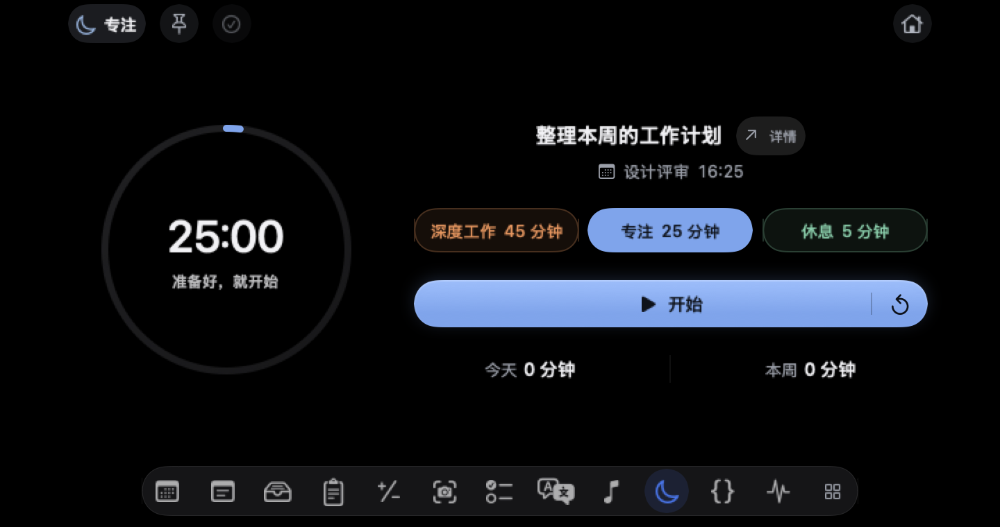

以下图片于 **2026-11-18** 从当前实际产品视图离屏导出，使用隔离的演示内容；不是实体刘海或桌面的实拍。应用支持中英文，图片展示中文版。AI 额度、任务与系统指标均为演示数据。

| 日历与接下来的安排 | 待办与下一步 |
| --- | --- |
| 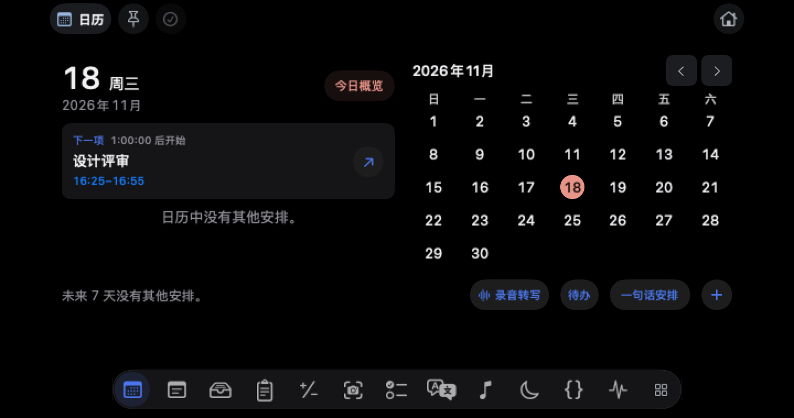 | 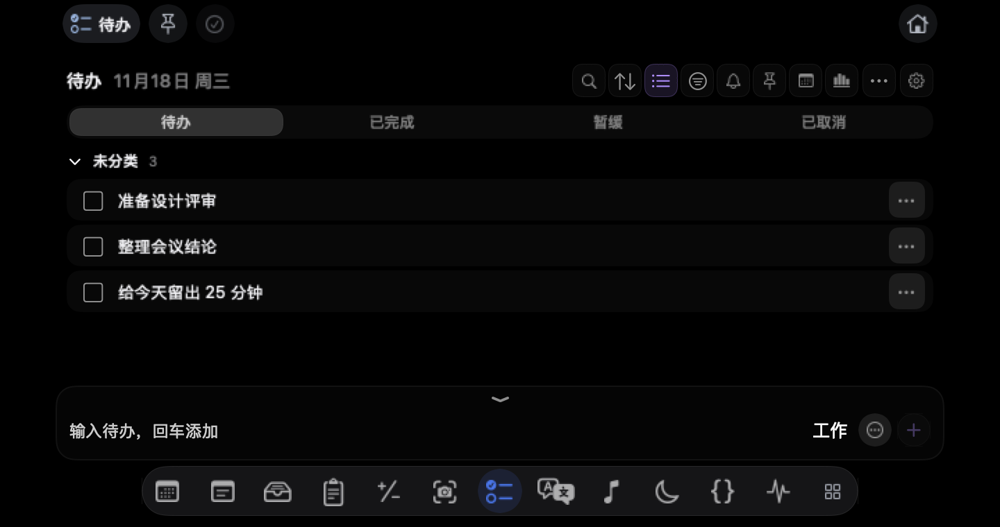 |
| 文件与常用目录 | 便笺卡片 |
| 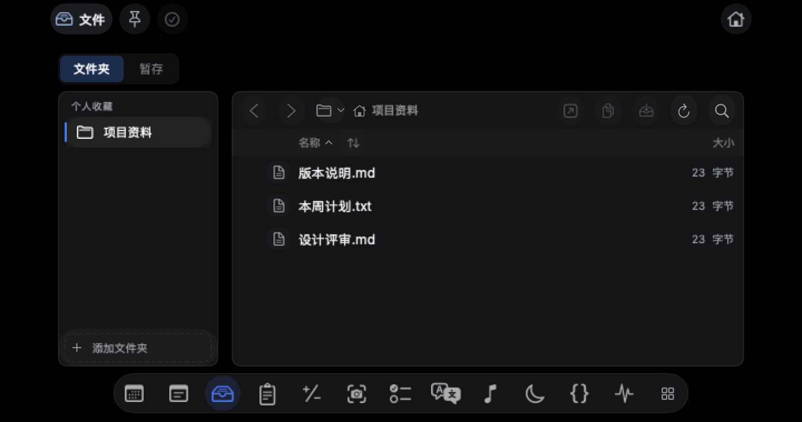 | 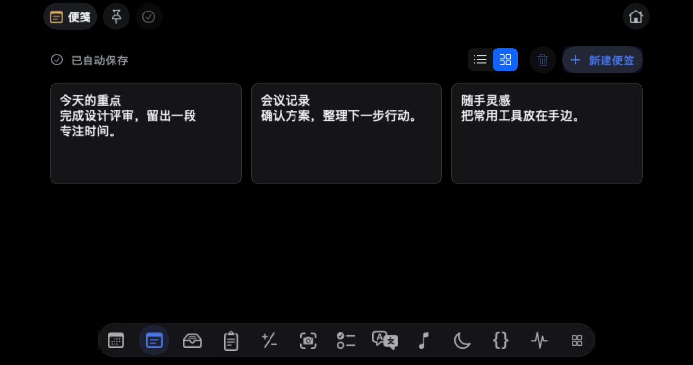 |
| 翻译服务 | 系统监控 |
| 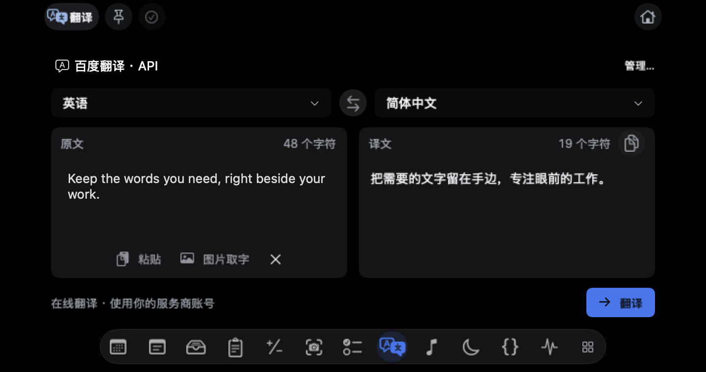 | 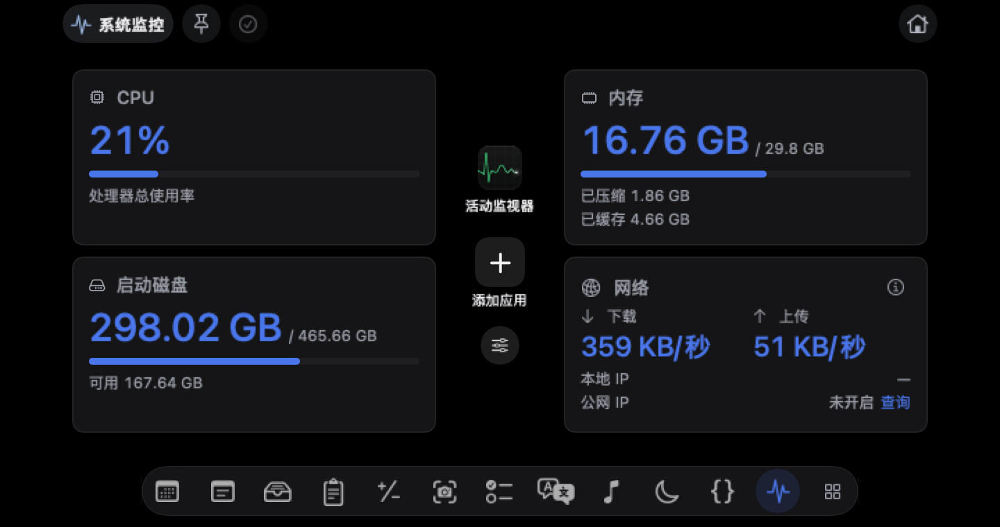 |
| 开发工具 | 截屏与录制 |
| 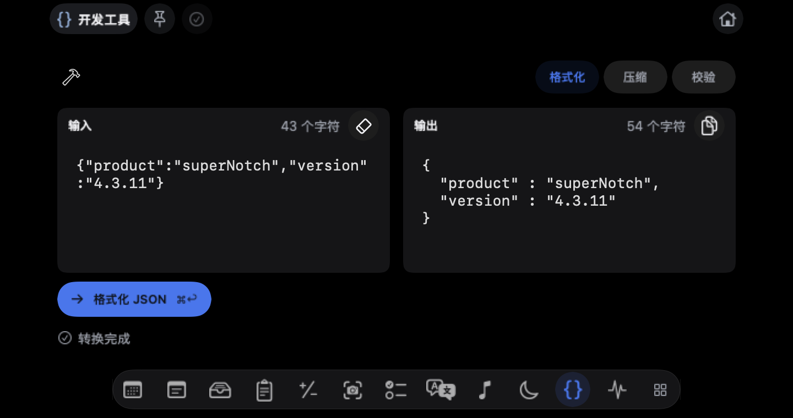 | 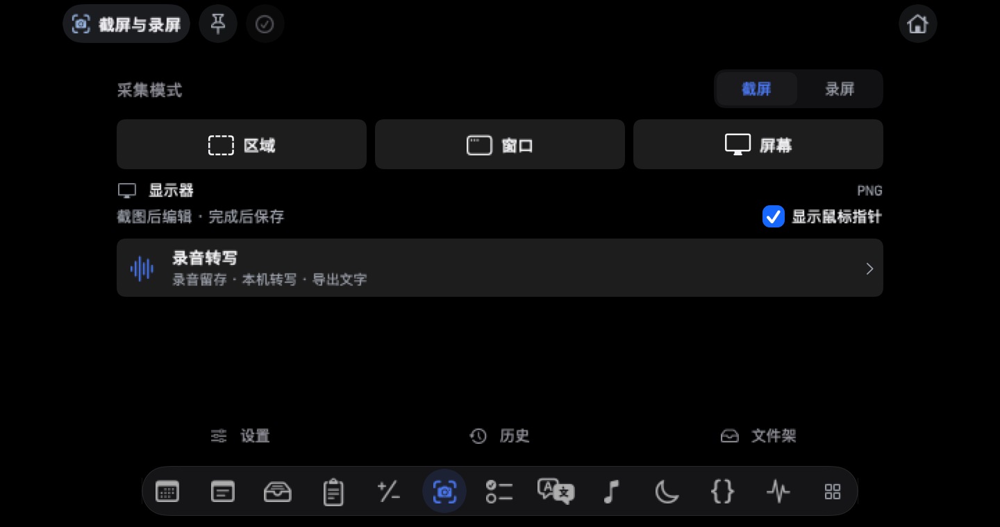 |
| 音乐 | 剪贴板历史 |
| 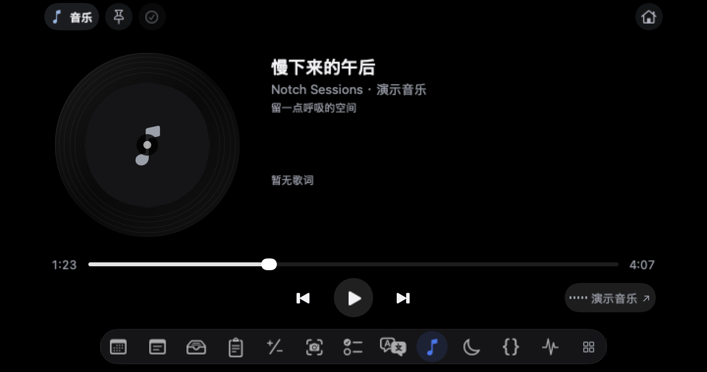 | 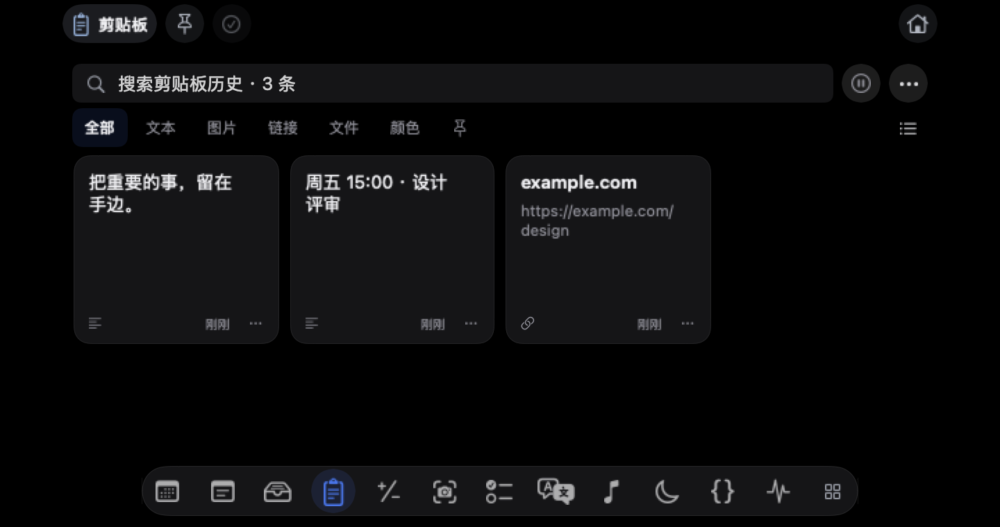 |
| AI 编程动态 | 助理能力管理 |
| 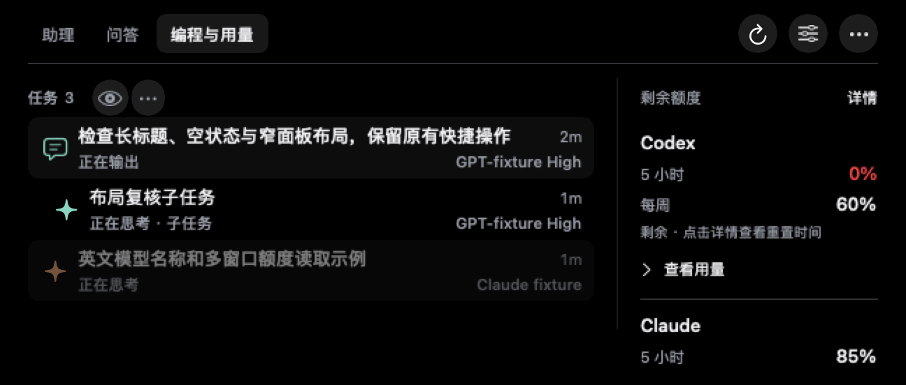 | 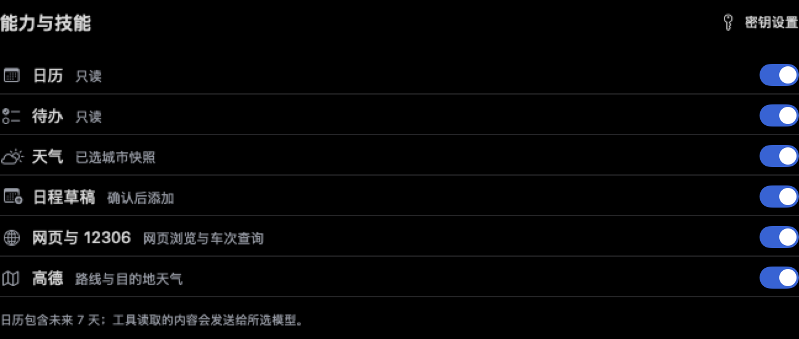 |

最后两张展示 AI 页面内容区域，不包含外层刘海工具栏。[图片来源与范围](images/current-4.3.11/manifest.json)。

## 可以用来做什么

- **安排与专注**：查看系统日历、下一场会议和空档，管理待办、专注计时与周回顾。
- **文件与记录**：浏览收藏目录、准备隔空投送，保存便笺卡片，按需开启和搜索剪贴板历史。
- **阅读与工具**：选择翻译网页或自配官方 API，本机识别图片文字；使用 JSON、时间戳、UUID 等开发工具。
- **AI 与自动化**：网页或 API 聊天、助理任务、编程动态和服务额度；可选组件支持 MCP、Skill 与执行记录，需先配置模型和所需服务。
- **采集与监控**：截图、录屏和会议录音转写，查看 CPU、内存、磁盘与网络状态。
- **按习惯调整**：浅色或深色工作台、可选半透明材质，自定义刘海尺寸、搜索功能库和显示屏。

## 最新版本：4.4.1

刘海顶部新增分享按钮，可分享小红书主页、官网和公开 GitHub 仓库，也可复制链接并打开微信。

[DMG](https://github.com/GpsLypy/NotchCalendar/releases/download/v4.4.1/NotchCalendar-4.4.1-macos.dmg) · [ZIP](https://github.com/GpsLypy/NotchCalendar/releases/download/v4.4.1/NotchCalendar-4.4.1-macos.zip) · [SHA-256](https://github.com/GpsLypy/NotchCalendar/releases/download/v4.4.1/SHA256SUMS.txt) · [历史版本](https://github.com/GpsLypy/NotchCalendar/releases)

## 安装与首次打开

从[官网](https://sweetchoice.cn/item/notchcalendar)下载安装包，将 `NotchCalendar.app` 拖入 Applications（应用程序），等待复制完成后从「应用程序」启动。安装包内附「安装说明.txt」。官网与应用内检查更新使用同一份 DMG，里面均为 `NotchCalendar.app`。

当前手动安装版采用 ad-hoc 签名，尚未经过 Apple 公证。确认来自官方发布页并核对校验值后，若首次打开被拦截，先尝试「系统设置 → 隐私与安全性 → 仍要打开」。若下载隔离仍阻止打开，可在终端执行：

```sh
sudo xattr -rd com.apple.quarantine "/Applications/NotchCalendar.app"
```

输入 Mac 管理员密码并按回车；输入时不显示字符是正常现象。应用名为 `superNotch.app` 或 `Notch Calendar.app` 时，请使用「应用程序」中对应的实际路径。若提示「已损坏」，请重新下载。GitHub 附件可使用发布页上的 `SHA256SUMS.txt` 核对。[Apple 的打开说明](https://support.apple.com/zh-cn/102445)。

## 授权、隐私与权限

当前应用为闭源发行。**¥9.9 一次买断，永久使用并包含未来版本更新**；付款后需联系作者领取激活码，不会自动激活。将付款记录与安装标识发送至 **498988598@qq.com**。历史 MIT 版本保留原有许可，见 [LICENSE](LICENSE) 与 [历史许可声明](THIRD_PARTY_NOTICES.md)。

日历、麦克风、屏幕录制等权限按功能需要申请。第三方 AI 与翻译会将主动提交的内容发送至所配置的服务，可能需要账号或 API 凭证。本机 OCR 不会自动把识别文字提交给翻译网页。可选 AI 组件当前提供 Apple 芯片版。网页登录、真实 API、原生交互、外接屏、Intel 实机与长期性能仍有待实机验收。
